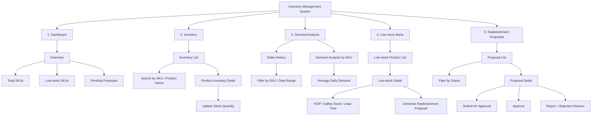
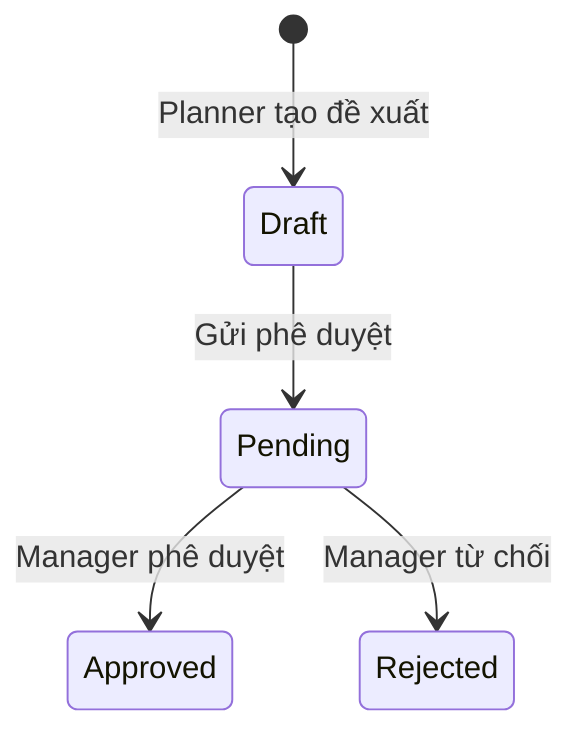

# Information Architecture — Inventory Management System

## 1. Mục tiêu kiến trúc thông tin

Kiến trúc thông tin được tổ chức theo luồng nghiệp vụ chính:

**Theo dõi tồn kho → Phân tích nhu cầu → Phát hiện sắp hết hàng → Tạo đề xuất nhập hàng → Phê duyệt**

Hệ thống có ba vai trò:

- **Warehouse Staff:** xem và cập nhật tồn kho.
- **Inventory Planner:** theo dõi tồn kho, phân tích nhu cầu và quản lý đề xuất nhập hàng.
- **Manager:** theo dõi tổng quan và phê duyệt hoặc từ chối đề xuất.

## 2. Sitemap



## 3. Cấu trúc phân cấp màn hình

```text
Inventory Management System
├── Dashboard                                      [Manager]
│   └── Overview
│       ├── Total SKUs
│       ├── Low-stock SKUs
│       └── Pending proposals
│
├── Inventory                                      [Warehouse Staff, Planner]
│   ├── Inventory list
│   │   ├── Search by SKU
│   │   └── Search by product name
│   └── Product inventory detail
│       ├── SKU, product name, unit
│       ├── Current stock quantity
│       └── Update stock quantity                  [Warehouse Staff]
│
├── Demand Analysis                                [Planner]
│   ├── Sales history
│   │   ├── Filter by SKU
│   │   └── Filter by date range
│   └── Demand analysis by SKU
│       ├── Historical sales summary
│       └── Average daily demand
│
├── Low-stock Alerts                               [Planner]
│   ├── Low-stock product list
│   └── Low-stock detail
│       ├── Current stock
│       ├── Average daily demand
│       ├── Lead time
│       ├── Safety stock
│       ├── Reorder point (ROP)
│       └── Generate replenishment proposal
│
└── Replenishment Proposals                        [Planner, Manager]
    ├── Proposal list
    │   ├── Filter by status
    │   └── Proposal status
    └── Proposal detail
        ├── SKU and product information
        ├── Current stock
        ├── Outstanding purchase order quantity
        ├── Recommended quantity
        ├── Calculation basis
        ├── Submit for approval                    [Planner]
        ├── Approve                                [Manager]
        └── Reject + required reason               [Manager]
```

## 4. Điều hướng theo vai trò

| Khu vực | Warehouse Staff | Inventory Planner | Manager |
|---|:---:|:---:|:---:|
| Dashboard | — | — | Xem |
| Inventory | Xem, cập nhật | Xem | — |
| Sales History | — | Xem | — |
| Demand Analysis | — | Xem | — |
| Low-stock Alerts | — | Xem | — |
| Replenishment Proposals | — | Tạo, xem, gửi duyệt | Xem, duyệt, từ chối |

### Menu chính đề xuất

- **Warehouse Staff:** Inventory.
- **Inventory Planner:** Inventory, Demand Analysis, Low-stock Alerts, Replenishment Proposals.
- **Manager:** Dashboard, Replenishment Proposals.

## 5. Liên kết chéo quan trọng

- Từ **Dashboard / Low-stock SKUs** đến **Low-stock Product List**.
- Từ **Dashboard / Pending Proposals** đến danh sách đề xuất đã lọc theo trạng thái `Pending`.
- Từ một SKU trong **Inventory List**, **Sales History** hoặc **Low-stock List** đến trang chi tiết tương ứng của SKU đó.
- Từ **Low-stock Detail** đến luồng **Generate Replenishment Proposal**.
- Sau khi Planner gửi duyệt, chuyển đến **Proposal Detail** với trạng thái `Pending`.
- Sau khi Manager duyệt hoặc từ chối, giữ người dùng tại **Proposal Detail** và hiển thị trạng thái mới.

## 6. Quy ước trạng thái đề xuất



`Draft` là trạng thái giao diện cần thiết để Planner xem lại đề xuất trước khi gửi duyệt. Nếu MVP chỉ lưu đề xuất sau khi gửi, có thể bỏ trạng thái này và tạo trực tiếp ở trạng thái `Pending`.

## 7. Phạm vi MVP và ngoài phạm vi

Sitemap trên bao phủ US01–US10. Trong đó Dashboard và thao tác từ chối là phạm vi **Should Have**; các khu vực còn lại là **Must Have**.

Không đưa các khu vực sau vào sitemap MVP vì README đã xác định chúng nằm ngoài phạm vi hoặc chưa có yêu cầu:

- Purchase Order creation.
- Supplier management và supplier integration.
- Receiving, shipping hoặc warehouse transfer.
- User/role administration.
- System settings và audit log.

Đăng nhập, đăng xuất, `Access Denied` và `Not Found` có thể được bổ sung như các trang hệ thống khi yêu cầu xác thực được xác định, nhưng không được xem là module nghiệp vụ chính ở giai đoạn hiện tại.
