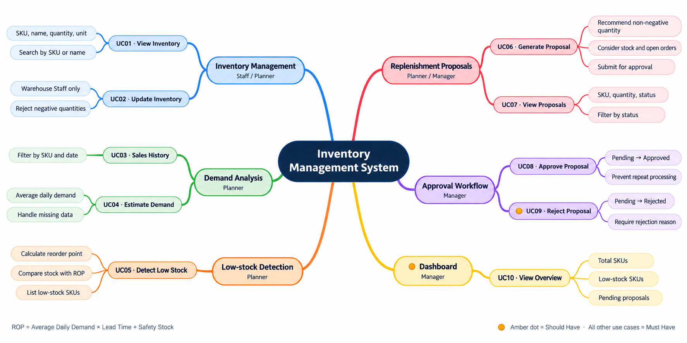
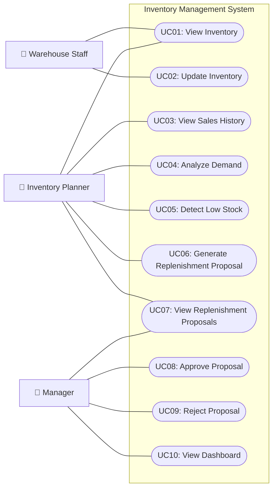
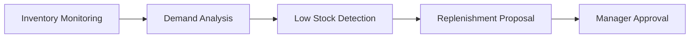

# Hệ thống quản lý tồn kho
## Mục tiêu
Xây dựng hệ thống quản lý tồn kho và đề xuất nhập thêm hàng, giúp doanh nghiệp tránh thiếu hàng hoặc tồn kho quá nhiều.
## Project cần làm gì?
1. **Quản lý tồn kho:** Theo dõi số lượng hàng hiện có theo từng sản phẩm (SKU).
2. **Phân tích nhu cầu:** Dựa trên dữ liệu bán hàng để ước tính lượng hàng tiêu thụ.
3. **Phát hiện thiếu hàng:** Xác định sản phẩm sắp hết hàng dựa trên tồn kho an toàn (Safety Stock) và điểm đặt hàng lại (Reorder Point).
4. **Đề xuất nhập hàng:** Tính toán khi nào cần nhập và nhập bao nhiêu.
5. **Phê duyệt đề xuất:** Cho phép người quản lý duyệt hoặc từ chối đề xuất nhập hàng.
6. **Dashboard:** Hiển thị tình trạng tồn kho, hàng sắp hết và các đề xuất cần xử lý.

# Inventory Management System

## Objective
Develop an inventory management and replenishment recommendation system that helps businesses prevent stockouts and reduce excess inventory.

## Project Requirements
1. **Inventory Management:** Track current stock quantities for each product (SKU).
2. **Demand Analysis:** Analyze historical sales data to estimate product demand.
3. **Low Stock Detection:** Identify products at risk of running out of stock using Safety Stock and Reorder Point (ROP).
4. **Replenishment Recommendations:** Determine when to reorder products and recommend appropriate order quantities.
5. **Approval Workflow:** Allow managers to approve or reject replenishment proposals.
6. **Dashboard:** Display inventory status, low-stock alerts, and pending replenishment proposals.

## 0. Mindmap

## 1. Use Case Diagram

### 1.1. Actors

| Actor | Responsibility |
|---|---|
| Warehouse Staff | View and update inventory |
| Inventory Planner | Analyze demand, detect low stock, generate replenishment proposals |
| Manager | Approve/reject proposals and monitor dashboard |

### 1.2. Use Case Diagram (Mermaid)

### 1.3. Use Case List

| ID | Use Case | Actor |
|---|---|---|
| UC01 | View Inventory | Warehouse Staff, Inventory Planner |
| UC02 | Update Inventory | Warehouse Staff |
| UC03 | View Sales History | Inventory Planner |
| UC04 | Analyze Demand | Inventory Planner |
| UC05 | Detect Low Stock | Inventory Planner |
| UC06 | Generate Replenishment Proposal | Inventory Planner |
| UC07 | View Replenishment Proposals | Inventory Planner, Manager |
| UC08 | Approve Proposal | Manager |
| UC09 | Reject Proposal | Manager |
| UC10 | View Dashboard | Manager |

---

## 2. User Stories (INVEST)

### 2.1. INVEST Principles

| Principle | Meaning |
|---|---|
| I — Independent | User Story có thể phát triển và kiểm thử tương đối độc lập |
| N — Negotiable | Chi tiết triển khai có thể thảo luận và điều chỉnh |
| V — Valuable | Mang lại giá trị cho người dùng hoặc doanh nghiệp |
| E — Estimable | Có thể ước lượng công sức thực hiện |
| S — Small | Đủ nhỏ để hoàn thành trong một iteration |
| T — Testable | Có tiêu chí nghiệm thu rõ ràng |

### 2.2. User Stories

#### US01 — View Inventory

**As a** Warehouse Staff,  
**I want to** view current stock quantities by SKU,  
**So that** I can monitor inventory levels.

**Acceptance Criteria:**
- Display SKU, product name, quantity and unit.
- Allow searching by SKU or product name.

**Priority:** Must Have

#### US02 — Update Inventory

**As a** Warehouse Staff,  
**I want to** update stock quantities,  
**So that** inventory records remain accurate.

**Acceptance Criteria:**
- Allow updating stock quantities.
- Reject negative quantities.
- Save changes successfully.

**Priority:** Must Have

#### US03 — View Sales History

**As an** Inventory Planner,  
**I want to** view historical sales data,  
**So that** I can understand product demand.

**Acceptance Criteria:**
- Display historical sales by SKU.
- Support filtering by date range.

**Priority:** Must Have

#### US04 — Analyze Demand

**As an** Inventory Planner,  
**I want to** calculate average daily demand,  
**So that** I can estimate product consumption.

**Acceptance Criteria:**
- Calculate average daily demand from sales history.
- Display the calculated demand for each SKU.
- Handle missing sales data.

**Priority:** Must Have

#### US05 — Detect Low Stock

**As an** Inventory Planner,  
**I want to** identify products below their reorder point,  
**So that** I can prevent stockouts.

**Acceptance Criteria:**
- Calculate Reorder Point (ROP).
- Mark products requiring replenishment.
- Display a list of low-stock products.

**Business Rule:**

Reorder Point = Average Daily Demand × Lead Time + Safety Stock

**Priority:** Must Have

#### US06 — Generate Replenishment Proposal

**As an** Inventory Planner,  
**I want to** generate replenishment recommendations,  
**So that** I can plan purchases efficiently.

**Acceptance Criteria:**
- Generate proposals for products requiring replenishment.
- Calculate a non-negative recommended quantity using a defined target stock level.
- Consider current stock and outstanding purchase orders.
- Allow the planner to submit proposals for approval.

**Priority:** Must Have

#### US07 — View Replenishment Proposals

**As an** Inventory Planner,  
**I want to** view replenishment proposals,  
**So that** I can review suggested orders.

**Acceptance Criteria:**
- Display SKU and recommended quantity.
- Display proposal status.
- Support filtering by status.

**Priority:** Must Have

#### US08 — Approve Proposal

**As a** Manager,  
**I want to** approve replenishment proposals,  
**So that** purchasing can proceed.

**Acceptance Criteria:**
- Only Managers can approve proposals.
- Change status from Pending to Approved.
- Prevent approving an already processed proposal.

**Priority:** Must Have

#### US09 — Reject Proposal

**As a** Manager,  
**I want to** reject unnecessary replenishment proposals,  
**So that** unnecessary purchases can be avoided.

**Acceptance Criteria:**
- Only Managers can reject proposals.
- Require a rejection reason.
- Change status from Pending to Rejected.

**Priority:** Should Have

#### US10 — View Dashboard

**As a** Manager,  
**I want to** view an inventory dashboard,  
**So that** I can monitor inventory status and pending approvals.

**Acceptance Criteria:**
- Display total number of SKUs.
- Display number of low-stock SKUs.
- Display number of pending proposals.

**Priority:** Should Have

---

## 3. Use Case — User Story Mapping

| Use Case | User Story | Priority |
|---|---|---|
| UC01 | US01 | Must |
| UC02 | US02 | Must |
| UC03 | US03 | Must |
| UC04 | US04 | Must |
| UC05 | US05 | Must |
| UC06 | US06 | Must |
| UC07 | US07 | Must |
| UC08 | US08 | Must |
| UC09 | US09 | Should |
| UC10 | US10 | Should |

## 4. MVP Scope

**Must Have:** US01–US08

**Should Have:** US09–US10

### Main Business Flow

**Note:** Approval creates an approved replenishment proposal. Actual purchase order creation and supplier integration are outside the MVP scope.

## 5. Information Architecture

Xem cấu trúc sitemap, phân cấp màn hình và điều hướng theo vai trò tại [Information Architecture](./INFORMATION_ARCHITECTURE.md).
