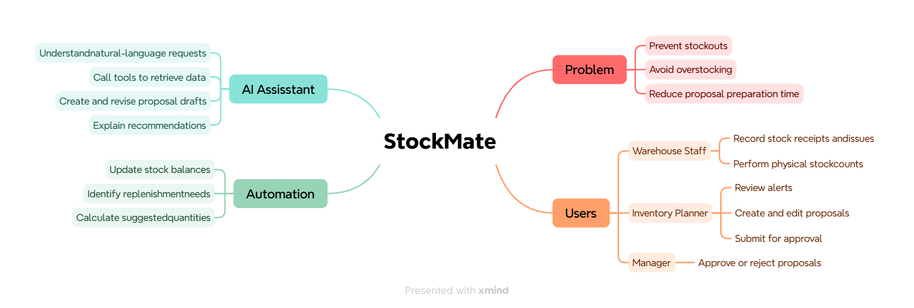

# StockMate — Inventory Management System

## Objective

Develop an inventory management and replenishment system that helps a store avoid stockouts and excess inventory. A generative AI assistant helps the Inventory Planner prepare and revise proposals; the backend calculates quantities and costs, and people review and approve the results.

## Project Requirements

1. **Inventory Management:** Track stock by SKU and record receipts, sales issues and physical-count adjustments.
2. **Demand Analysis:** Calculate average daily demand from the most recent 30 completed calendar days of sales.
3. **Low Stock Detection:** Compare Inventory Position with the Reorder Point (ROP).
4. **Replenishment Proposals:** Prepare and edit proposals through forms or the AI assistant, with products, suppliers, quantities, costs and a budget.
5. **Approval Workflow:** Allow Managers to approve or reject submitted proposals.
6. **Dashboard:** Display inventory status, replenishment alerts and pending proposals.
7. **Supporting Data:** Let the Planner manage products, suppliers, prices, inventory policies, placed orders and customer backorders through forms.
8. **Account Access:** Username/password login, logout and password changes for active users.
9. **User Administration:** A separate Admin creates accounts, assigns roles, locks/unlocks access and issues temporary passwords.

## 0. Mindmap

Account access and administration are specified in UC13/US13 and UC14/US14 below.

## 1. Use Case Diagram

### 1.1. Actors

| Actor | Responsibility |
|---|---|
| Admin | Manage accounts and access; no business permissions by default |
| Warehouse Staff | View inventory; record receipts, sales issues, backorder deliveries and count adjustments |
| Inventory Planner | Manage planning data; analyze demand; track placed orders and backorders; prepare, edit and submit proposals |
| Manager | Approve/reject proposals and monitor the dashboard |

The AI assistant supports the Planner and can only create or edit proposal drafts.

### 1.2. Use Case Diagram (Mermaid)

~~~mermaid
flowchart LR
    Staff["Warehouse Staff"]
    Planner["Inventory Planner"]
    Manager["Manager"]
    Admin["Admin"]
    Users["All users"]

    subgraph IMS["StockMate"]
        UC13(["UC13: Sign In / Sign Out / Change Password"])
        UC14(["UC14: Administer Users"])
        UC01(["UC01: View Inventory"])
        UC02(["UC02: Update Inventory"])
        UC03(["UC03: View Sales History"])
        UC04(["UC04: Analyze Demand"])
        UC05(["UC05: Detect Low Stock"])
        UC06(["UC06: Prepare Replenishment Proposal"])
        UC07(["UC07: View Replenishment Proposals"])
        UC08(["UC08: Approve Proposal"])
        UC09(["UC09: Reject Proposal"])
        UC10(["UC10: View Dashboard"])
        UC11(["UC11: Manage Products and Suppliers"])
        UC12(["UC12: Track Placed Orders and Backorders"])
    end

    Users --- UC13
    Admin --- UC14
    Staff --- UC01
    Staff --- UC02

    Planner --- UC01
    Planner --- UC03
    Planner --- UC04
    Planner --- UC05
    Planner --- UC06
    Planner --- UC07
    Planner --- UC11
    Planner --- UC12

    Manager --- UC07
    Manager --- UC08
    Manager --- UC09
    Manager --- UC10
~~~

### 1.3. Use Case List

| ID | Use Case | Actor |
|---|---|---|
| UC01 | View Inventory | Warehouse Staff, Inventory Planner |
| UC02 | Update Inventory | Warehouse Staff |
| UC03 | View Sales History | Inventory Planner |
| UC04 | Analyze Demand | Inventory Planner |
| UC05 | Detect Low Stock | Inventory Planner |
| UC06 | Prepare Replenishment Proposal through forms or AI | Inventory Planner |
| UC07 | View Replenishment Proposals | Inventory Planner, Manager |
| UC08 | Approve Proposal | Manager |
| UC09 | Reject Proposal | Manager |
| UC10 | View Dashboard | Manager |
| UC11 | Manage Products and Suppliers, including prices and inventory policies | Inventory Planner |
| UC12 | Track Placed Orders and Customer Backorders | Inventory Planner |
| UC13 | Sign In, Sign Out and Change Password | All users |
| UC14 | Administer User Accounts | Admin |

Receipts and customer deliveries are part of UC02. UC12 records what is still expected from suppliers or owed to customers.

## 2. User Stories (INVEST)

### 2.1. INVEST Principles

| Principle | Meaning |
|---|---|
| I — Independent | A story can be developed and checked relatively independently |
| N — Negotiable | Implementation details can be discussed and refined |
| V — Valuable | A story provides value to users or the business |
| E — Estimable | The work can be estimated |
| S — Small | A story is small enough for an iteration |
| T — Testable | A story has clear acceptance criteria |

### 2.2. User Stories

#### US01 — View Inventory

**As a** Warehouse Staff member or Inventory Planner,

**I want to** view current inventory by SKU,

**So that** I can monitor stock levels.

**Acceptance Criteria:**

- Display SKU, product name, unit, on-hand stock, on-order stock and backorders.
- Display Inventory Position.
- Allow searching by SKU or product name.

**Priority:** Must Have

#### US02 — Update Inventory

**As a** Warehouse Staff member,

**I want to** record stock receipts, sales issues and count adjustments,

**So that** inventory records remain accurate.

**Acceptance Criteria:**

- Receiving against a placed order increases on-hand stock and reduces on-order stock.
- A sales issue reduces on-hand stock and adds to sales history.
- A delivery against a customer backorder also reduces the quantity owed to that customer; record the sale once.
- A physical count updates on-hand stock and records the adjustment reason; it is not a sale.
- Allow partial receipts and deliveries, but reject quantities above stock or the quantity still outstanding.
- Record who made each change, when and why.

**Priority:** Must Have

#### US03 — View Sales History

**As an** Inventory Planner,

**I want to** view historical sales data,

**So that** I can understand product demand.

**Acceptance Criteria:**

- Display sales by SKU.
- Support filtering by date range.
- Include deliveries to waiting customers once; exclude receipts and count adjustments.

**Priority:** Must Have

#### US04 — Analyze Demand

**As an** Inventory Planner,

**I want to** calculate average daily demand,

**So that** I can estimate product consumption.

**Acceptance Criteria:**

- Calculate demand from sales in the most recent 30 completed calendar days.
- Average Daily Demand = Total Sales in the Period / 30.
- Display the result for each SKU.
- Report missing sales data rather than treating it as zero.

**Priority:** Must Have

#### US05 — Detect Low Stock

**As an** Inventory Planner,

**I want to** identify products at or below their reorder point,

**So that** I can prevent stockouts.

**Acceptance Criteria:**

- Calculate Inventory Position and ROP.
- Flag a product when Inventory Position is less than or equal to ROP.
- Display replenishment needs and the values used in the calculation.
- Run these checks daily or on request.

**Business Rules:**

~~~text
Inventory Position = On-hand Stock + On-order Stock − Backorders
ROP = Average Daily Demand × Lead Time + Safety Stock
Replenishment is needed when Inventory Position <= ROP.
~~~

**Priority:** Must Have

#### US06 — Prepare Replenishment Proposal

**As an** Inventory Planner,

**I want to** create and revise replenishment proposals through forms or AI,

**So that** I can plan purchases efficiently.

**Acceptance Criteria:**

- A proposal can contain multiple products and suppliers.
- The Planner chooses the supplier when a product has multiple suppliers.
- Suggested Quantity = max(0, Target Stock − Inventory Position).
- Let the Planner change quantities, remove products and enter a budget for the proposal.
- Recalculate line costs and the total after changes.
- Show the amount over budget and block submission until the Planner corrects it; do not automatically reduce quantities.
- AI only creates or edits drafts, uses retrieved data and backend calculations, and explains its recommendations.
- The Planner reviews and submits the draft. Forms remain available if AI fails.

**Priority:** Must Have

#### US07 — View Replenishment Proposals

**As an** Inventory Planner or Manager,

**I want to** view replenishment proposals,

**So that** I can track or review planned purchases.

**Acceptance Criteria:**

- Display products, suppliers, quantities, costs, total and budget.
- Display status and support filtering by status.
- The Planner can review their drafts; the Manager reviews submitted proposals.
- Show edit and approval history.

**Priority:** Must Have

#### US08 — Approve Proposal

**As a** Manager,

**I want to** approve replenishment proposals,

**So that** purchasing can proceed.

**Acceptance Criteria:**

- Only Managers can approve a Pending proposal.
- Change status from Pending to Approved and record the reviewer and time.
- Prevent processing an already approved or rejected proposal.
- Approval alone does not place an order or change stock.

**Priority:** Must Have

#### US09 — Reject Proposal

**As a** Manager,

**I want to** reject unsuitable proposals and explain why,

**So that** the Planner can revise the purchasing plan.

**Acceptance Criteria:**

- Only Managers can reject a Pending proposal.
- Require a reason and change status to Rejected.
- The Planner can copy a rejected proposal into a new draft.
- Keep the original rejected proposal and its history unchanged.

**Priority:** Must Have

#### US10 — View Dashboard

**As a** Manager,

**I want to** view an inventory dashboard,

**So that** I can monitor stock and pending approvals.

**Acceptance Criteria:**

- Display total active SKUs.
- Display the number of SKUs needing replenishment.
- Display the number of pending proposals.
- Distinguish missing data from sufficient stock.

**Priority:** Should Have

#### US11 — Manage Products and Suppliers

**As an** Inventory Planner,

**I want to** manage products, suppliers, prices and inventory policies,

**So that** proposals use the necessary planning data.

**Acceptance Criteria:**

- Enter and update this data through forms.
- Associate products with suppliers and their prices.
- Record lead time, safety stock and target stock.
- Preserve historical proposal information when current data changes.

**Priority:** Must Have

#### US12 — Track Placed Orders and Backorders

**As an** Inventory Planner,

**I want to** record placed purchases and unmet customer quantities,

**So that** the system knows what is coming in and what is still owed.

**Acceptance Criteria:**

- Record purchases actually placed with a supplier; these increase on-order stock.
- Record quantities customers are waiting for because of a shortage; these increase backorders.
- Staff receipts and deliveries reduce the corresponding outstanding quantities.
- Allow the Planner to cancel only an unreceived or undelivered quantity, with a reason.
- Cancellation does not change on-hand stock; preserve the history.

**Priority:** Must Have

#### US13 — Sign In, Sign Out and Change Password

**As a** user with an active account,

**I want to** sign in with my username/password, sign out and change my password,

**So that** the system identifies me and applies my assigned permissions.

**Acceptance Criteria:**

- Normalize usernames to lowercase; reject incorrect credentials or locked accounts with a generic message.
- After login, open the appropriate workspace for Admin, Staff, Planner or Manager.
- Require a password change when the account has a temporary password. Only identity, password change and logout are available until completed.
- Passwords contain 8–128 characters; a new password must differ from the current password.
- Logout invalidates the current session. Locking, changing role or resetting a password invalidates the target user's sessions.
- The backend owns identity and permissions; URL parameters and UI controls cannot grant another role.

**Priority:** Must Have

#### US14 — Administer User Accounts

**As an** Admin,

**I want to** create accounts, update names/roles, lock/unlock accounts and assign temporary passwords,

**So that** each person receives the appropriate access.

**Acceptance Criteria:**

- Admin is a separate role and has no inventory or proposal permissions by default.
- Search/filter accounts by username/name, role and active status.
- Each account has one role and a unique, immutable username (3–32 letters, digits, periods, underscores or hyphens, normalized to lowercase).
- Create active accounts with a temporary password and mandatory first-login change; no public registration or email recovery.
- Do not hard-delete accounts or rewrite historical transactions when names/roles/status change.
- Disallow self-locking/self-demotion and removal of the last active Admin.
- Log account changes and password resets with actor, target and time; never log credentials.

**Priority:** Must Have

## 3. Use Case — User Story Mapping

| Use Case | User Story | Priority |
|---|---|---|
| UC01 | US01 | Must |
| UC02 | US02 | Must |
| UC03 | US03 | Must |
| UC04 | US04 | Must |
| UC05 | US05 | Must |
| UC06 | US06 | Must |
| UC07 | US07 | Must |
| UC08 | US08 | Must |
| UC09 | US09 | Must |
| UC10 | US10 | Should |
| UC11 | US11 | Must |
| UC12 | US12 | Must |
| UC13 | US13 | Must |
| UC14 | US14 | Must |

## 4. MVP Scope

**Must Have:** US01–US09, US11–US14.

**Should Have:** US10.

One warehouse, four roles (Admin, Warehouse Staff, Inventory Planner and Manager) and data entered through forms. Users sign in through Admin-provisioned accounts. The system supports partial receipts/deliveries and cancellation of outstanding quantities.

### Main Business Flow

~~~mermaid
flowchart LR
    A["Inventory Monitoring"] --> B["Demand Analysis"]
    B --> C["Low Stock Detection"]
    C --> D["Prepare Draft through Form or AI"]
    D --> E["Planner Review and Submission"]
    E --> F["Manager Approval or Rejection"]
~~~

After approval, the Planner records an order actually placed with the supplier. Staff then record receipts against that order.

Accuracy, role-based permissions and change history are required. Core forms must work when AI is unavailable; AI must report missing information and use backend calculations.

**Outside the MVP:** automatic supplier integration, payments/accounting, shared budget funds and multiple warehouses. Detailed technical mechanisms are implementation choices, not additional business requirements.

The agreed decisions are summarized in [Business Rules](./docs/BUSINESS_RULES.md).

## 5. Information Architecture

See [Information Architecture](./docs/information_architecture/INFORMATION_ARCHITECTURE.md) for the sitemap, screen hierarchy and role-based navigation.

## 6. UI/UX

See [UI/UX Walkthrough](./docs/ui_ux/UI_UX_WALKTHROUGH.md) for role journeys, account access, screen actions and feedback. The local HTML/CSS/JavaScript prototype includes four demo accounts and account administration.

## 7. Database Design

See [Database Design](./docs/database/DATABASE_DESIGN.md) for the tables, ER diagram and data rules supporting the MVP.

## 8. API Specification

See [API Overview](./docs/api/README.md), [OpenAPI YAML](./docs/api/openapi.yaml) or [OpenAPI JSON](./docs/api/openapi.json). The API files are technical drafts; they do not add business scope beyond this README.

## 9. C4 Architecture

See [C4 Architecture](./docs/c4_architecture/C4_ARCHITECTURE.md) for the proposed system context, containers, backend components, existing prototype code mapping and key interaction flows. The document distinguishes implemented prototype modules from the backend, database and AI integration that remain to be built.
