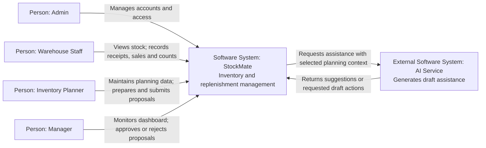
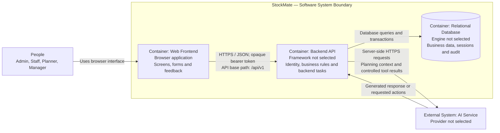
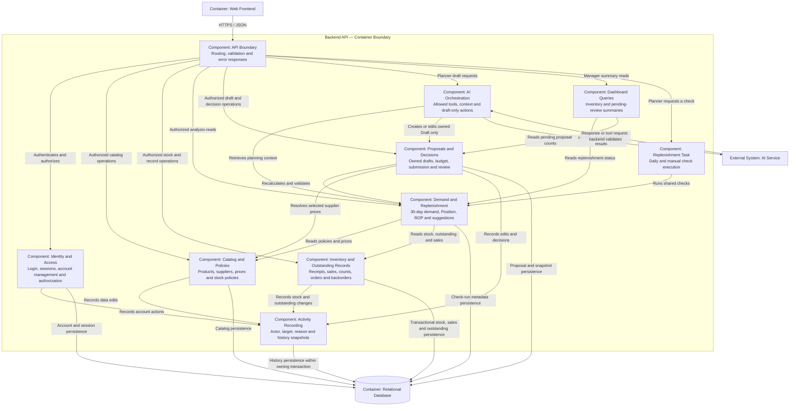

# StockMate — C4 Architecture

## 1. Purpose and Status

This document describes the proposed architecture supporting US01–US14 in the [project requirements](../../README.md). It uses C4 levels to describe the system boundary, runtime containers and backend responsibilities. Diagrams use Mermaid with explicit element types; they are architectural views, not deployment instructions.

The repository contains a working browser-local HTML/CSS/JavaScript prototype. The Backend API, relational database and external AI integration described below are **not implemented**. Backend language/framework, database engine, AI provider and hosting platform have not been selected.

The target is one warehouse, four user roles and a single modular Backend API. Components below are logical modules in that backend, not separately deployed microservices. Daily replenishment checks run as a backend task using the same calculation services as manual checks.

## 2. C1 — System Context

StockMate manages inventory, demand analysis, replenishment proposals, account access and approval decisions. People enter supplier orders and customer backorders through forms. Suppliers and customers do not connect to StockMate automatically.



| Actor or system | Responsibility and boundary |
|---|---|
| Admin | Creates/updates accounts, assigns one role, locks/unlocks access and issues temporary passwords. No inventory or proposal permissions by default. |
| Warehouse Staff | Views inventory and outstanding records; records receipts, sales/backorder deliveries and physical counts. |
| Inventory Planner | Maintains products/suppliers/prices/policies and outstanding records; analyzes demand; prepares, edits, submits and copies proposals. Drafts belong to their creator. |
| Manager | Views submitted proposals and dashboard; approves/rejects Pending proposals with recorded decisions. |
| AI Service | External generation capability called through the backend. It does not own calculations, permissions or business data. |

Automatic supplier integration, payments/accounting, shared budget funds and multiple warehouses are outside the MVP. Public registration and email-based password recovery are not included.

## 3. C2 — Containers

In C4, a container is an application or data store; it does not imply Docker or any particular infrastructure technology.



| Container | Main responsibilities | Related design |
|---|---|---|
| Web Frontend | Login, account administration and role-specific inventory/planning/review screens; collect inputs, display server results and explain errors. | [IA](../information_architecture/INFORMATION_ARCHITECTURE.md), [UI/UX walkthrough](../ui_ux/UI_UX_WALKTHROUGH.md) |
| Backend API | Authenticate and authorize requests, calculate quantities/costs, enforce transitions and ownership, coordinate transactions, run daily/manual replenishment checks and mediate AI requests. | [API overview](../api/README.md), [OpenAPI YAML](../api/openapi.yaml), [OpenAPI JSON](../api/openapi.json) |
| Relational Database | Store accounts, revocable sessions, product/supplier data, inventory, sales, outstanding quantities, proposal snapshots and activity history. | [Database design](../database/DATABASE_DESIGN.md) |

The database is reached by the backend, not directly by browsers or the AI service. Frontend arithmetic may provide feedback, but the backend calculates and validates authoritative results before saving or submitting changes.

The browser-local prototype runs independently of this proposed container structure. It uses localStorage for sample data/accounts, sessionStorage for per-tab sessions and simulated AI responses; its optional Node.js server serves static files only. It is not a deployed Backend API.

## 4. C3 — Backend Components

The view below expands the Backend API container. Every client request enters through the API boundary. Authentication/authorization precedes protected operations, including AI-triggered actions.



| Component | Responsibilities and main data |
|---|---|
| API Boundary | Maps HTTP requests to use cases, validates request shape, returns safe errors and applies access checks before business handlers. Login is public; other routes require valid sessions. |
| Identity and Access | Manages USERS and AUTH_SESSIONS, password verification, temporary-password restrictions and role/ownership policies. Enforces account invariants and session invalidation. |
| Catalog and Policies | Maintains PRODUCTS, SUPPLIERS, SUPPLIER_PRODUCTS and REPLENISHMENT_POLICIES without rewriting submitted proposal snapshots. |
| Inventory and Outstanding Records | Maintains INVENTORY, STOCK_MOVEMENTS, PLACED_ORDERS, CUSTOMER_BACKORDERS and DAILY_SALES. Receipts/deliveries/cancellations validate outstanding quantities; counts are not sales. |
| Demand and Replenishment | Uses the last 30 completed Asia/Saigon calendar days; distinguishes missing data from confirmed zero. Computes Position, ROP and suggested quantities using current inputs. Check-run metadata follows the existing API contract; its physical storage remains an implementation choice. |
| Replenishment Task | Invokes the same checks daily or on Planner request. It does not create proposals or orders automatically. Exact scheduling and run coordination are implementation details. |
| Proposals and Decisions | Maintains REPLENISHMENT_PROPOSALS and items, creator ownership, selected quantities, supplier prices, separate budget and submitted snapshots. Only Planner submits; only Manager decides. Copies preserve rejected originals. |
| AI Orchestration | Retrieves permitted context, calls the external model and validates requested actions before invoking normal draft services. Handles failure with a form fallback; no direct database access by the model. |
| Dashboard Queries | Provides Manager totals for active SKUs, replenishment needs, missing data and Pending proposals. Does not grant Manager inventory-edit rights. |
| Activity Recording | Writes ACTIVITY_LOG with actor/target IDs, historical name snapshots, time and reason. Business audit writes participate in the owning transaction; this is not a separate eventual-consistency service. |

Arrows show logical calls or persistence access, not a requirement for separate services, queues or repository classes. A deployment view and physical module structure can be added when implementation technologies are selected.

## 5. C4 — Code View and Existing Modules

There is no implemented backend class model to document at C4 code level. Inventing backend classes or claiming the prototype is the target backend would misrepresent the repository. The existing source mapping is:

| Existing module | Implemented responsibility |
|---|---|
| [index.html](../ui_ux/prototype/index.html) | Browser entry point and script/style loading. |
| [styles.css](../ui_ux/prototype/styles.css) | Layout, visual presentation and responsive screens. |
| [app.js](../ui_ux/prototype/app.js) | Sample business data, local calculations, routing, role-specific screens and workflow interactions. |
| [auth.js](../ui_ux/prototype/auth.js) | Local account/session simulation, salted PBKDF2 password verifiers, account changes and per-tab session checks. |
| [account-views.js](../ui_ux/prototype/account-views.js) | Login, password-change and Admin account-management views. |
| [serve.mjs](../ui_ux/prototype/serve.mjs) | Optional static-file preview server; no business endpoints. |
| [verify.mjs](../ui_ux/prototype/verify.mjs) | Browser workflow checks and representative screenshot capture. |

Prototype modules are browser/UI code and verification support, not backend components. Browser storage and client-side checks do not supply production authentication or authorization. See the [prototype guide](../ui_ux/prototype/README.md) for execution instructions and limitations.

## 6. Dynamic Views

### 6.1. Login and Session Revocation

This sequence describes the proposed backend contract. Tokens are opaque bearer tokens, not JWTs. AUTH_SESSIONS stores token hashes; raw passwords and tokens are not recorded in audit history.

```mermaid
sequenceDiagram
    actor User
    actor Admin
    participant Web as Web Frontend
    participant API as Backend API
    participant Auth as Identity and Access
    participant DB as Relational Database

    User->>Web: Enter username and password
    Web->>API: POST /auth/login over HTTPS
    API->>Auth: Verify normalized username, active state and password
    Auth->>DB: Read user; create session with token hash and auth_version
    Auth-->>Web: Login response via API: token and safe user details
    Note over Web,Auth: Temporary password restricts access to identity, logout and password change
    Web->>API: Protected request with bearer token
    API->>Auth: Check token, expiry, active state, auth_version and permission
    Auth->>DB: Validate current session and account
    Auth-->>API: Allow request or reject
    Admin->>Web: Lock target account
    Web->>API: PATCH /users/{userId} using Admin session
    API->>Auth: Authorize Admin and validate account invariants
    Auth->>DB: Atomically update active state and auth_version; invalidate target sessions; audit
    User->>Web: Perform another action
    Web->>API: Protected request using prior token
    API->>Auth: Validate session again
    Auth->>DB: Read current account/session state
    Auth-->>Web: 401 via API; login required
```

Logout revokes the current session. Password reset/change and role/status changes invalidate previous target sessions. A successful password change returns one replacement session for the current client. Proposed tokens expire within eight hours; prototype sessions instead follow the tab lifecycle.

### 6.2. AI-Assisted Draft, Submission and Review

```mermaid
sequenceDiagram
    actor Planner
    actor Manager
    participant API as Backend API
    participant AIFlow as AI Orchestration
    participant Model as External AI Service
    participant Demand as Demand and Replenishment
    participant Proposal as Proposals and Decisions
    participant DB as Relational Database

    Planner->>API: Request help preparing or editing own Draft
    API->>AIFlow: Authorized Planner request
    AIFlow->>Demand: Retrieve permitted planning context and calculations
    Demand-->>AIFlow: Current values or explicit missing-data result
    AIFlow->>Model: Context and allowed draft-only tool interface
    Model-->>AIFlow: Explanation or requested draft actions
    AIFlow->>Proposal: Validate and execute permitted draft actions
    Proposal->>Demand: Recalculate through shared business logic
    Proposal->>DB: Save Draft and audit within transaction
    API-->>Planner: Draft result and explanation
    Note over Planner,API: Forms remain available if AI fails; over-budget drafts cannot be submitted
    Planner->>API: Review and submit Draft with expected calculation fingerprint
    API->>Proposal: Check creator, Draft state and current version
    Proposal->>Demand: Recalculate current stock, policies, prices and demand
    alt Inputs changed, missing data or over budget
        Proposal-->>Planner: Conflict or validation response via API; remain Draft
    else Reviewed calculation is valid
        Proposal->>DB: Freeze snapshots, set Pending and record submission
        Manager->>API: Approve or reject Pending proposal
        API->>Proposal: Check Manager permission, Pending state and version
        Proposal->>DB: Atomically save decision, reviewer, time and audit
        Proposal-->>Manager: Decision via API; remain on detail
    end
    Note over Proposal,DB: Approval does not create a supplier order or change stock
```

AI actions use the same ownership, validation and calculation services as forms. AI cannot submit, approve/reject, edit catalog data or record stock/order changes. Selected quantities are not automatically reduced to satisfy a budget.

## 7. Cross-Cutting Rules

| Concern | Architectural rule |
|---|---|
| Identity and access | Server-owned identity; check session, account state, forced-password-change restrictions, role and resource ownership. URL parameters and frontend controls cannot grant permissions. Admin does not inherit business roles. |
| Account integrity | Unique immutable usernames; no hard deletion; preserve user IDs and history. Prevent self-lock/self-demotion and removal of the last active Admin using consistent updates. |
| Session and credential handling | Use revocable opaque bearer tokens and AUTH_SESSIONS. Hash passwords and stored tokens; never expose hashes or log passwords/raw tokens. The browser PBKDF2 demonstration does not select a production password-storage implementation. |
| Stock consistency | Update stock, linked outstanding quantities, sales contributions and history in the same transaction. Validate versions and remaining quantities; prevent duplicate movement recording. |
| Calculations | Position = on-hand + on-order − backorders; demand = sales over 30 completed days / 30; ROP = demand × lead time + safety stock. Alert at Position ≤ ROP; suggestion = max(0, target − Position). Missing data is not zero. |
| Proposal integrity | Compute costs from selected quantity and supplier price, check each proposal's budget and freeze submitted snapshots. Enforce Draft → Pending → Approved/Rejected with one decision. Preserve rejected originals when copying. |
| Human decisions | Planner submits and Manager decides. Approval does not place orders; only an actually placed purchase recorded by Planner increases on-order. |
| AI boundary and resilience | Expose only permitted draft actions and the minimum relevant planning context. The backend validates every requested action and uses authoritative calculations. Form workflows remain usable when AI is unavailable. |
| Audit | Preserve actor/target IDs, historical display names, timestamps, reasons and decisions alongside successful changes. Credentials and raw tokens do not enter the audit log. |

## 8. Related Documents

- [Project requirements and use cases](../../README.md)
- [Information Architecture](../information_architecture/INFORMATION_ARCHITECTURE.md)
- [Business Rules](../BUSINESS_RULES.md)
- [Database Design](../database/DATABASE_DESIGN.md)
- [API overview](../api/README.md), [OpenAPI YAML](../api/openapi.yaml), [OpenAPI JSON](../api/openapi.json)
- [UI/UX Walkthrough](../ui_ux/UI_UX_WALKTHROUGH.md) and [prototype guide](../ui_ux/prototype/README.md)
