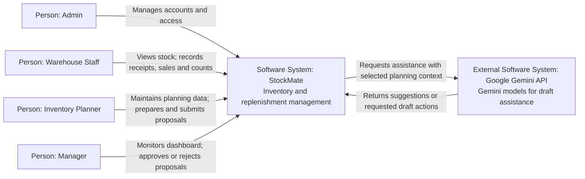
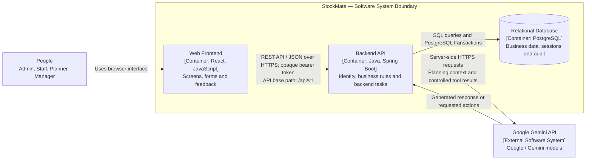
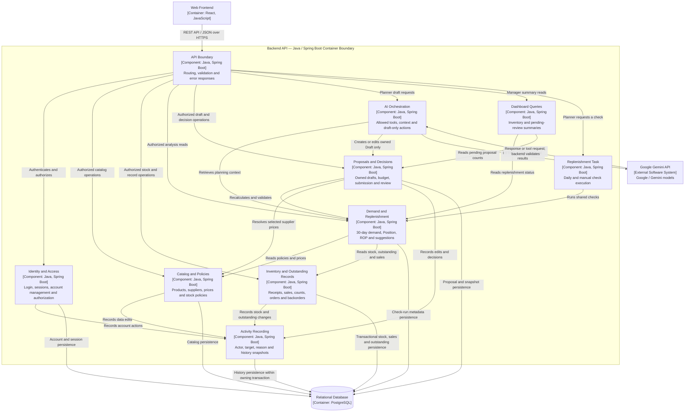

# StockMate — C4 Architecture

## 1. Purpose and Status

This document describes the proposed architecture supporting US01–US14 in the [project requirements](../../README.md). It covers C1 (System Context), C2 (Containers) and C3 (Components) to describe the system boundary, runtime containers and backend responsibilities. Diagrams use Mermaid with explicit element types; they are architectural views, not deployment instructions.

The repository contains a working browser-local HTML/CSS/JavaScript prototype. The Backend API, relational database and external AI integration described below are **not implemented**. The selected target stack is React with JavaScript and Vite for the frontend, Java with Spring Boot for the Backend API, and PostgreSQL for the relational database. The frontend communicates with the backend through a REST API using JSON over HTTPS. The selected AI provider is Google, accessed through the Gemini API using the Gemini model family. The exact model ID will be configured during implementation. The hosting platform has not been selected.

The target is one warehouse, four user roles and a single modular Backend API. Components below are logical modules in that backend, not separately deployed microservices. Daily replenishment checks run as a backend task using the same calculation services as manual checks.

## 2. C1 — System Context

StockMate manages inventory, demand analysis, replenishment proposals, account access and approval decisions. People enter supplier orders and customer backorders through forms. Suppliers and customers do not connect to StockMate automatically.

| Actor or system | Responsibility and boundary |
|---|---|
| Admin | Creates/updates accounts, assigns one role, locks/unlocks access and issues temporary passwords. No inventory or proposal permissions by default. |
| Warehouse Staff | Views inventory and outstanding records; records receipts, sales/backorder deliveries and physical counts. |
| Inventory Planner | Maintains products/suppliers/prices/policies and outstanding records; analyzes demand; prepares, edits, submits and copies proposals. Drafts belong to their creator. |
| Manager | Views submitted proposals and dashboard; approves/rejects Pending proposals with recorded decisions. |
| Google Gemini API | External generation capability from Google Gemini models, called through the backend. It does not own calculations, permissions or business data. |

Automatic supplier integration, payments/accounting, shared budget funds and multiple warehouses are outside the MVP. Public registration and email-based password recovery are not included.

## 3. C2 — Containers

In C4, a container is an application or data store; it does not imply Docker or any particular infrastructure technology. Labels use `[Container: technology]` and `[Component: technology]` to identify element types and implementation technologies. `TBD` means a technology decision is still pending; it is not an implemented stack. C1 shows people and software systems without framework details.

| Container / technology | Main responsibilities | Related design |
|---|---|---|
| Web Frontend — React, JavaScript; Vite build tooling | Login, account administration and role-specific inventory/planning/review screens; collect inputs, display server results and explain errors. | [IA](../information_architecture/INFORMATION_ARCHITECTURE.md), [UI/UX walkthrough](../ui_ux/UI_UX_WALKTHROUGH.md) |
| Backend API — Java, Spring Boot | Authenticate and authorize requests, calculate quantities/costs, enforce transitions and ownership, coordinate transactions, run daily/manual replenishment checks and mediate AI requests. | [API overview](../openapi/README.md), [OpenAPI YAML](../openapi/openapi.yaml), [OpenAPI JSON](../openapi/openapi.json) |
| Relational Database — PostgreSQL | Store accounts, revocable sessions, product/supplier data, inventory, sales, outstanding quantities, proposal snapshots and activity history. | [Database design](../database/DATABASE_DESIGN.md) |

The target frontend is a React application written in JavaScript, with Vite used for local development and production builds. Vite is build tooling, not a separate runtime container. The Backend API is a modular Java / Spring Boot application backed by PostgreSQL. Browser-to-backend communication follows the REST API contract at `/api/v1`, with JSON payloads over HTTPS. AI assistance uses Google Gemini models through the Gemini API. The exact model ID is configurable on the backend and will be selected during implementation. Hosting remains TBD; framework and database versions will be pinned during implementation.

The database is reached by the backend, not directly by browsers or the AI service. Frontend arithmetic may provide feedback, but the backend calculates and validates authoritative results before saving or submitting changes.

The browser-local prototype runs independently of this proposed container structure. It uses localStorage for sample data/accounts, sessionStorage for per-tab sessions and simulated AI responses; its optional Node.js server serves static files only. It is not a deployed Backend API.

## 4. C3 — Backend Components

The view below expands the Backend API container. Every client request enters through the API boundary. Authentication/authorization precedes protected operations, including AI-triggered actions.

| Component | Responsibilities and main data |
|---|---|
| API Boundary | Maps HTTP requests to use cases, validates request shape, returns safe errors and applies access checks before business handlers. Login is public; other routes require valid sessions. |
| Identity and Access | Manages USERS and AUTH_SESSIONS, password verification, temporary-password restrictions and role/ownership policies. Enforces account invariants and session invalidation. |
| Catalog and Policies | Maintains PRODUCTS, SUPPLIERS, SUPPLIER_PRODUCTS and REPLENISHMENT_POLICIES without rewriting submitted proposal snapshots. |
| Inventory and Outstanding Records | Maintains INVENTORY, STOCK_MOVEMENTS, PLACED_ORDERS, CUSTOMER_BACKORDERS and DAILY_SALES. Receipts/deliveries/cancellations validate outstanding quantities; counts are not sales. |
| Demand and Replenishment | Uses the last 30 completed Asia/Saigon calendar days; distinguishes missing data from confirmed zero. Computes Position, ROP and suggested quantities using current inputs. Check-run metadata follows the existing API contract; its physical storage remains an implementation choice. |
| Replenishment Task | Invokes the same checks daily or on Planner request. It does not create proposals or orders automatically. Exact scheduling and run coordination are implementation details. |
| Proposals and Decisions | Maintains REPLENISHMENT_PROPOSALS and items, creator ownership, selected quantities, supplier prices, separate budget and submitted snapshots. Only Planner submits; only Manager decides. Copies preserve rejected originals. |
| AI Orchestration | Retrieves permitted context, calls the configured Google Gemini model through the Gemini API and validates requested actions before invoking normal draft services. Handles failure with a form fallback; no direct database access by the model. |
| Dashboard Queries | Provides Manager totals for active SKUs, replenishment needs, missing data and Pending proposals. Does not grant Manager inventory-edit rights. |
| Activity Recording | Writes ACTIVITY_LOG with actor/target IDs, historical name snapshots, time and reason. Business audit writes participate in the owning transaction; this is not a separate eventual-consistency service. |

Arrows show logical calls or persistence access, not a requirement for separate services, queues or repository classes. All backend components are modules within the same Java / Spring Boot application. A deployment view and physical module structure can be added when hosting and implementation layout are defined.

## 5. Cross-Cutting Rules

| Concern | Architectural rule |
|---|---|
| Identity and access | Server-owned identity; check session, account state, forced-password-change restrictions, role and resource ownership. URL parameters and frontend controls cannot grant permissions. Admin does not inherit business roles. |
| Account integrity | Unique immutable usernames; no hard deletion; preserve user IDs and history. Prevent self-lock/self-demotion and removal of the last active Admin using consistent updates. |
| Session and credential handling | Use revocable opaque bearer tokens and AUTH_SESSIONS. Hash passwords and stored tokens; never expose hashes or log passwords/raw tokens. The browser PBKDF2 demonstration does not select a production password-storage implementation. |
| Stock consistency | Update stock, linked outstanding quantities, sales contributions and history in the same transaction. Validate versions and remaining quantities; prevent duplicate movement recording. |
| Calculations | Position = on-hand + on-order − backorders; demand = sales over 30 completed days / 30; ROP = demand × lead time + safety stock. Alert at Position ≤ ROP; suggestion = max(0, target − Position). Missing data is not zero. |
| Proposal integrity | Compute costs from selected quantity and supplier price, check each proposal's budget and freeze submitted snapshots. Enforce Draft → Pending → Approved/Rejected with one decision. Preserve rejected originals when copying. |
| Human decisions | Planner submits and Manager decides. Approval does not place orders; only an actually placed purchase recorded by Planner increases on-order. |
| AI boundary and resilience | Expose only permitted draft actions and the minimum relevant planning context. The backend validates every requested action and uses authoritative calculations. Form workflows remain usable when AI is unavailable. |
| Audit | Preserve actor/target IDs, historical display names, timestamps, reasons and decisions alongside successful changes. Credentials and raw tokens do not enter the audit log. |

## 6. Related Documents

- [Project requirements and use cases](../../README.md)
- [Information Architecture](../information_architecture/INFORMATION_ARCHITECTURE.md)
- [Business Rules](../requirements/BUSINESS_RULES.md)
- [Database Design](../database/DATABASE_DESIGN.md)
- [API overview](../openapi/README.md), [OpenAPI YAML](../openapi/openapi.yaml), [OpenAPI JSON](../openapi/openapi.json)
- [UI/UX Walkthrough](../ui_ux/UI_UX_WALKTHROUGH.md) and [prototype guide](../ui_ux/prototype/README.md)
