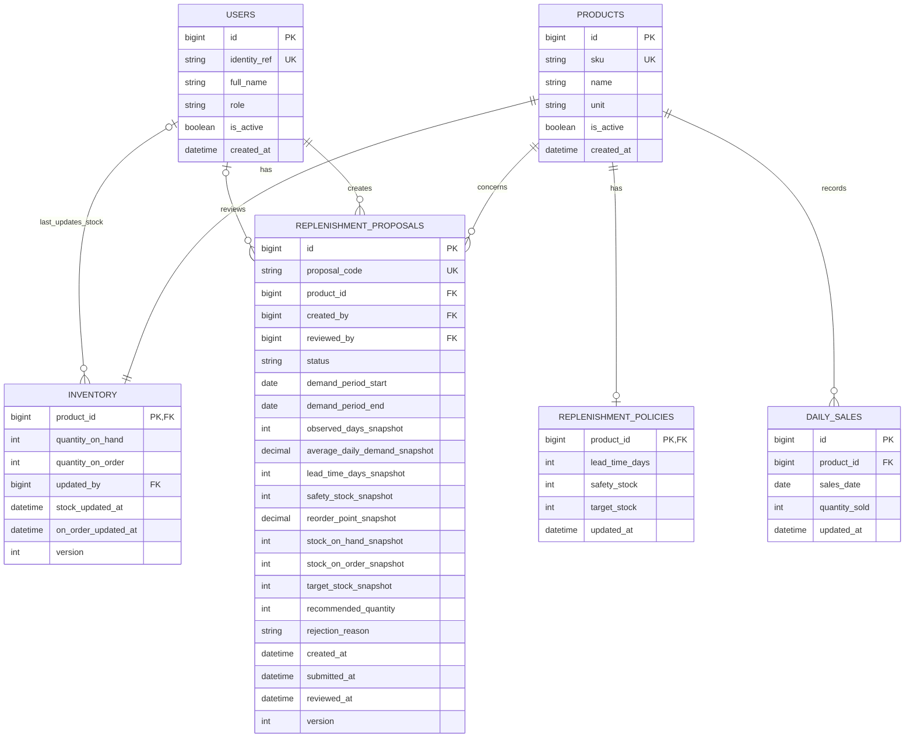

# Stockwise — Database Design

Database model for the current [requirements](../../README.md) and [UI/UX flows](../ui_ux/UI_UX_WALKTHROUGH.md).

## 1. Tables

| Table | Purpose | Example |
|---|---|---|
| `USERS` | User identity and role | Linh: Planner; Minh Anh: Manager |
| `PRODUCTS` | Product details | SKU-001, A4 paper, unit: ream |
| `INVENTORY` | Current stock and outstanding order quantities | 60 reams in stock, 100 on order |
| `REPLENISHMENT_POLICIES` | Reorder parameters and target stock | 7-day lead time, 40 safety stock, 500 target stock |
| `DAILY_SALES` | Daily sales per product | SKU-001: 24 reams sold on October 30 |
| `REPLENISHMENT_PROPOSALS` | Recommended orders and approval decisions | Proposal DX-2026-042: 340 reams, pending |

For the MVP, there is **one warehouse**, each user has **one role**, and each proposal is for **one product**. Purchase orders and suppliers are managed outside this system. Their outstanding quantities must be supplied separately.

## 2. Relationships and ER Diagram

- Each product has exactly one inventory record.
- Each product can have one replenishment policy, or none if it has not been configured.
- Each product can have many daily sales records and many proposals.
- Each proposal has one Planner who created it. It has no reviewer until a Manager processes it.
- An inventory record can reference the Staff member who last updated its stock.



## 3. Field Details

### Users and products

`USERS.role` is one of `WAREHOUSE_STAFF`, `INVENTORY_PLANNER` or `MANAGER`. `identity_ref` links a user to the login system selected later. A name is for display, not identification.

`PRODUCTS.sku` is the unique business code shown in the UI. `unit` tells users whether quantities mean reams, boxes, rolls or another unit. All quantities for a product use that same unit.

`is_active` lets the system stop using a user or product without deleting its history. User administration screens are outside the MVP.

### Inventory and policies

| Field | Meaning |
|---|---|
| `quantity_on_hand` | Total stock currently recorded in the warehouse |
| `quantity_on_order` | Stock ordered but not yet received |
| `updated_by`, `stock_updated_at` | Who last updated warehouse stock, and when |
| `on_order_updated_at` | When the outstanding order quantity was confirmed |
| `lead_time_days` | Expected days between ordering and receiving stock |
| `safety_stock` | Extra stock kept as a buffer |
| `target_stock` | Stock level used to calculate how much to order |
| `version` | A counter used to detect competing updates |

Create the product and its inventory record together. The policy can be added later. Missing policy data must produce a missing-data message, not a calculation using assumed zeros.

For outstanding orders, **NULL means unknown; 0 means confirmed none**. Do not generate a calculated recommendation until this quantity is known. Its source/import process still needs to be defined; the current Staff UI only updates warehouse stock.

The last stock updater and update time can be NULL before the first Staff update. The order update time can be NULL while order data is unknown.

### Daily sales

Store one row per product per day. Enforce a unique pair of `(product_id, sales_date)`.

- A row with `quantity_sold = 0` means the day's data is available and nothing was sold.
- No row means the day's data is missing.

Proposed MVP rule: calculate demand only when every day in the selected period has data. Otherwise, ask the Planner to choose another period or supply the missing data.

### Proposals and snapshots

A proposal stores the product, its creator, the recommended quantity and its status. It also stores the numbers used to calculate that recommendation.

Snapshot fields preserve the calculation inputs at submission, even if current inventory or policies change later.

| Fields | Purpose |
|---|---|
| `demand_period_start`, `demand_period_end` | Sales period used for the calculation |
| `observed_days_snapshot`, `average_daily_demand_snapshot` | Number of days with data and calculated daily demand |
| `lead_time_days_snapshot`, `safety_stock_snapshot`, `reorder_point_snapshot` | Saved inputs and result for the reorder point |
| `stock_on_hand_snapshot`, `stock_on_order_snapshot` | Stock and outstanding orders used in the recommendation |
| `target_stock_snapshot`, `recommended_quantity` | Chosen target and resulting order quantity |
| `created_by`, `created_at` | Planner and creation time |
| `submitted_at` | Time the Planner submitted the proposal |
| `reviewed_by`, `reviewed_at` | Manager and decision time |
| `rejection_reason` | Explanation required when a proposal is rejected |

The target starts from the product policy, but the Planner can adjust it for a proposal as shown in the UI. Drafts may have incomplete calculation fields. All calculation fields must be complete before submission.

At submission, read current data and recalculate. If the result differs from the draft, let the Planner review it again. Save the final snapshots and change the status in one transaction. Do not edit snapshots after submission.

## 4. Calculation Example

For SKU-001, the UI shows:

```text
Average daily demand = 600 reams sold / 30 days = 20 reams/day
Reorder point (ROP)  = Daily demand × Lead time + Safety stock
                     = 20 × 7 + 40 = 180 reams

Current stock = 60 reams
60 < 180, so the product needs replenishment.

Recommended quantity = max(0, Target stock − Current stock − On-order stock)
                     = max(0, 500 − 60 − 100)
                     = 340 reams
```

Count the date range inclusively: `end date − start date + 1`. Use decimal values for demand and ROP, for example `DECIMAL(18,6)`. Stock, sales and order quantities are whole numbers in the current design.

Dashboard numbers, low-stock lists and charts come from queries over these tables. They do not need separate tables. Count active products, products with sufficient data and stock below ROP, and proposals with status `PENDING`. Missing data does not mean stock is sufficient. Use the same selected sales period when calculating demand and ROP.

## 5. Proposal status and permissions

```text
DRAFT → PENDING → APPROVED
                ↘ REJECTED
```

| Status | Meaning | Required information |
|---|---|---|
| `DRAFT` | Planner is preparing the proposal | Creator; target stock. Other calculation fields may be incomplete |
| `PENDING` | Submitted and waiting for a Manager | Submission time and complete calculation snapshots |
| `APPROVED` | Manager accepted it | Submission details, reviewer and review time |
| `REJECTED` | Manager declined it | Submission details, reviewer, review time and a non-empty reason |

`submitted_at` is NULL in drafts. `reviewed_by` and `reviewed_at` are NULL until a decision is made. `rejection_reason` is NULL unless rejected. Persisting drafts is a design choice to support the Draft filter in the UI.

Only Staff updates stock, only Planners create/submit proposals, and only Managers approve/reject. Enforce role checks when performing these actions.

Submitted proposals cannot be edited. Processed proposals cannot be approved or rejected again. Approval does not create a purchase order or change inventory.

## 6. Implementation checks

- Require unique SKUs, proposal codes and login identity references.
- Keep quantities, safety stock, target stock and lead time non-negative. Unknown on-order quantity may be NULL.
- Require valid roles/statuses, a valid date range and complete daily data before submission. Saved results must match the formulas.
- Check `version` before updating stock. If someone changed the row since it was loaded, ask the user to reload rather than overwrite it.
- Review a proposal only if its status is still `PENDING` and its `version` matches. Save the decision atomically to prevent two Managers from processing it twice.
- Keep referenced users and products; deactivate them instead of deleting them.

### Suggested indexes

| Index | Used for |
|---|---|
| UNIQUE `PRODUCTS(sku)` | Product lookup |
| UNIQUE `USERS(identity_ref)` | Login identity lookup |
| UNIQUE `DAILY_SALES(product_id, sales_date)` | Sales history and one daily record per product |
| UNIQUE `REPLENISHMENT_PROPOSALS(proposal_code)` | Proposal lookup |
| `REPLENISHMENT_PROPOSALS(status, submitted_at)` | Pending proposal lists |
| `REPLENISHMENT_PROPOSALS(created_by, created_at)` | Proposals by creator |
| `REPLENISHMENT_PROPOSALS(product_id, created_at)` | Proposals for a product |

Choose a product-name search index after selecting the database and search behavior. Inventory and policy primary keys already prevent multiple rows for the same product.

## 7. Outside this design

Multiple warehouses, supplier management, purchase order creation/receiving, stock movement records and a complete audit log are outside the current MVP. `updated_by` only remembers the last stock updater; it is not a full change history.

See [Information Architecture](../../INFORMATION_ARCHITECTURE.md) for navigation and [UI/UX Walkthrough](../ui_ux/UI_UX_WALKTHROUGH.md) for the screen flows.
