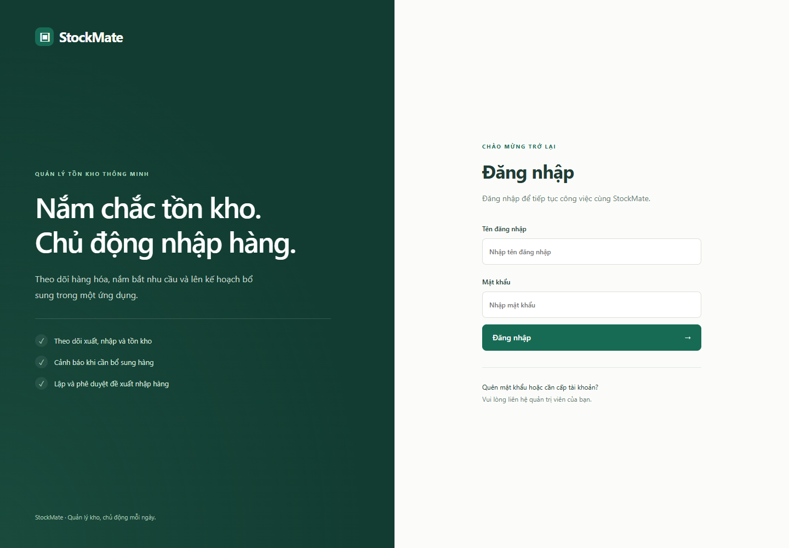
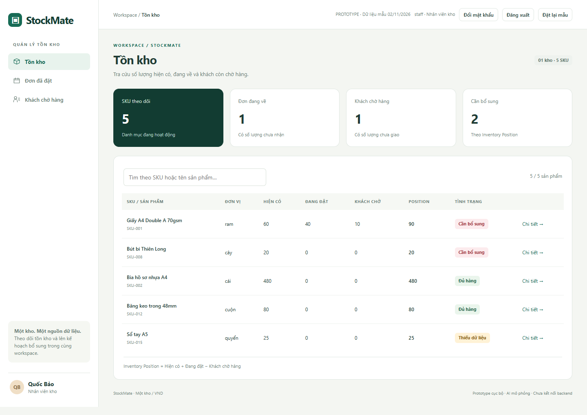
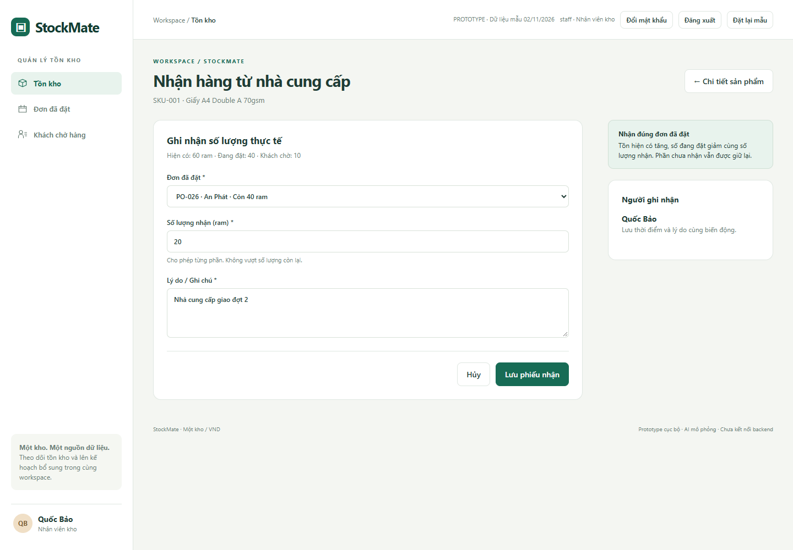
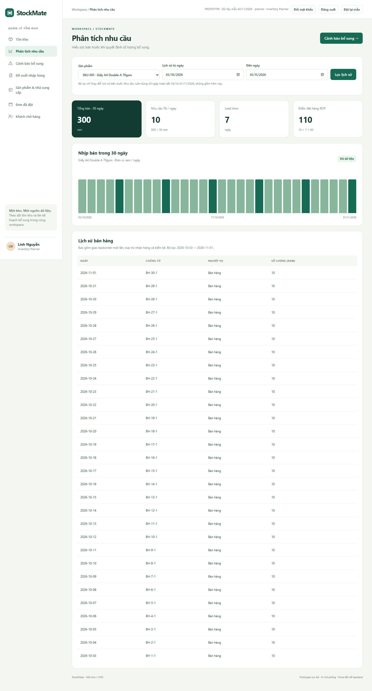
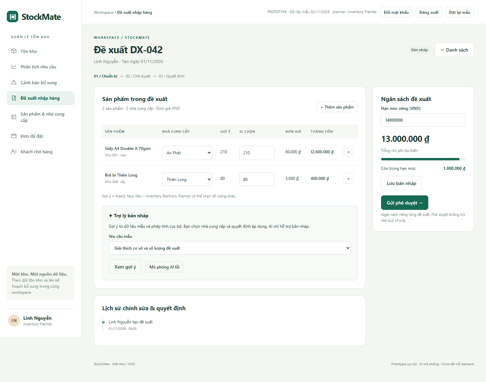
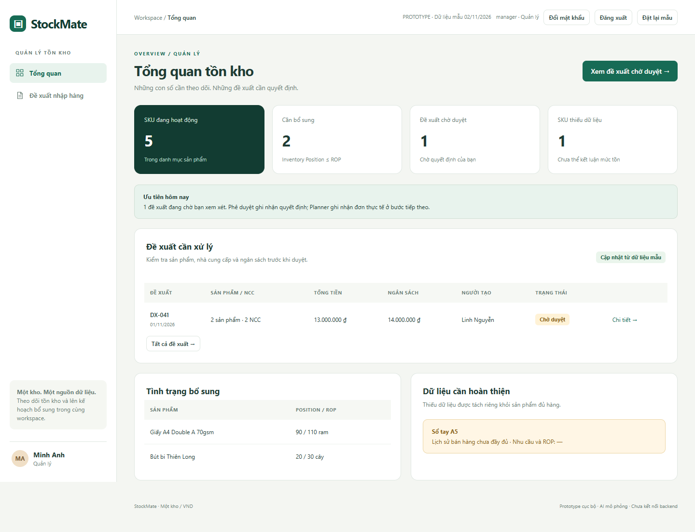
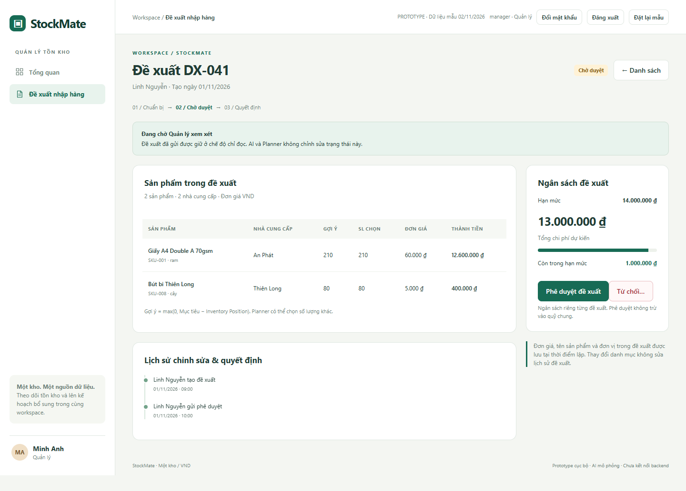
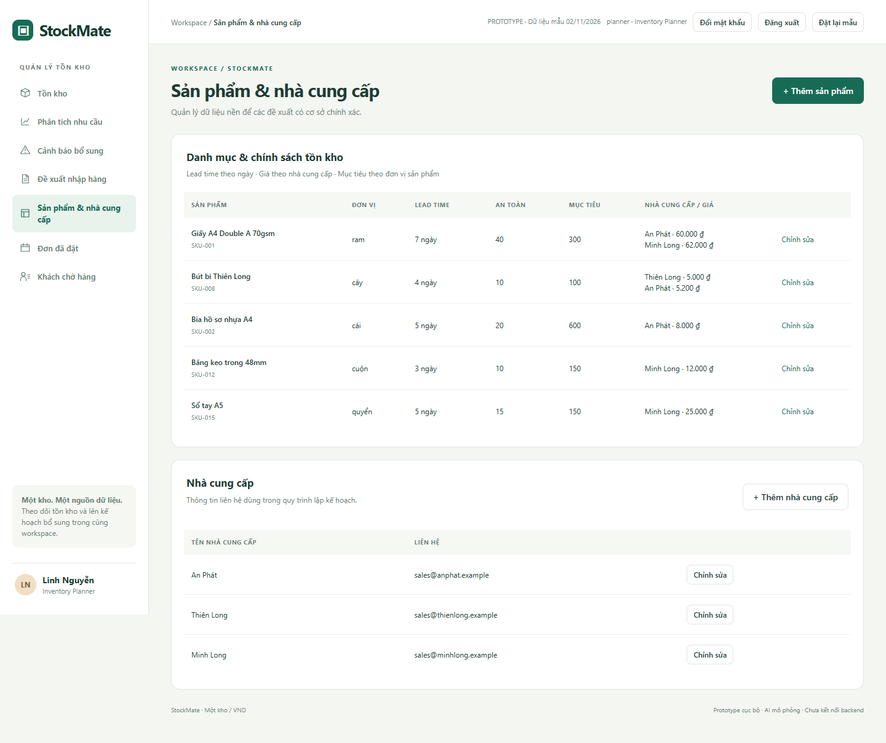
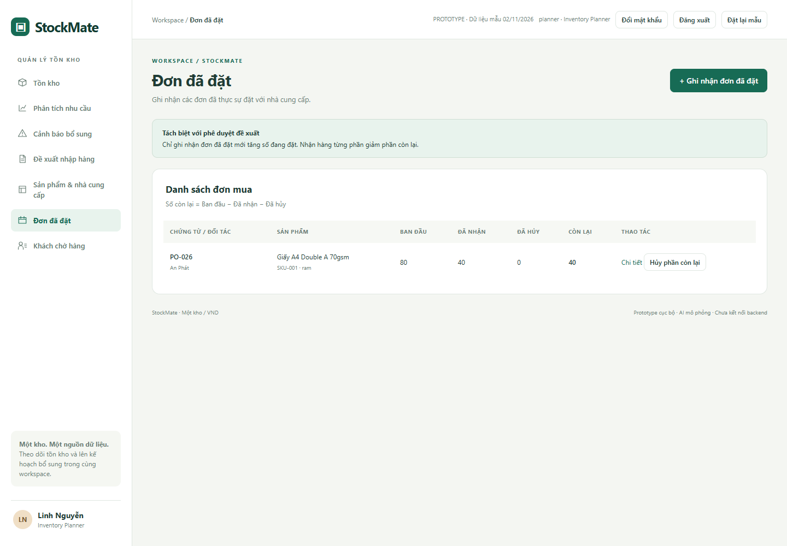
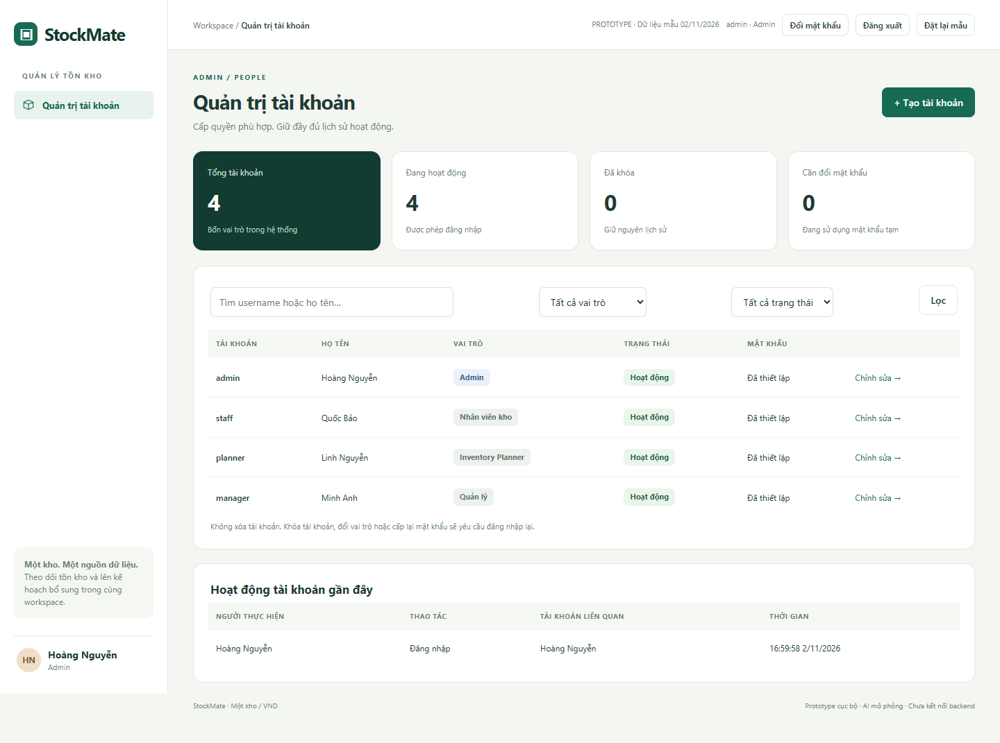

# StockMate — UI/UX Walkthrough

This document describes the current web prototype for US01–US14, aligned with the [project requirements](../../README.md), [Information Architecture](../information_architecture/INFORMATION_ARCHITECTURE.md) and [Business Rules](../requirements/BUSINESS_RULES.md).

StockMate demonstrates Inventory Position tracking, proposals with multiple products and suppliers, individual proposal budgets, AI-assisted drafts and outstanding records. The walkthrough uses 10 representative screenshots. Documentation is in English; the prototype interface and screenshots remain in Vietnamese. English action names below describe the corresponding controls in those screenshots.

### Screen catalog by function and role

Browse the [complete screen catalog](./prototype/screenshots/SCREENSHOT_INDEX.md): [Common](./prototype/screenshots/common/COMMON_SCREENS.md) · [Admin](./prototype/screenshots/admin/ADMIN_SCREENS.md) · [Warehouse Staff](./prototype/screenshots/warehouse_staff/WAREHOUSE_STAFF_SCREENS.md) · [Planner](./prototype/screenshots/planner/PLANNER_SCREENS.md) · [Manager](./prototype/screenshots/manager/MANAGER_SCREENS.md). Images are numbered by functional flow. Shared screens are in `common`; warehouse staff screens are in `warehouse_staff`. Catalogs cover pages, forms, dialogs and key states; the 10 illustrations below are retained.

## 1. Open and explore

Open [prototype/index.html](./prototype/index.html) directly in a browser. No build or frontend library is required. If localStorage is unavailable for local files, start the server from the repository root:

~~~sh
node docs/ui_ux/prototype/serve.mjs
~~~

Open **http://127.0.0.1:4173**. See the [prototype guide](./prototype/README.md) for source structure, data reset and screenshot capture instructions.

### Sign in and change passwords — US13

The login screen introduces StockMate with the message **Know your stock. Plan replenishment ahead.** Its two-panel layout contains the product introduction and a form with username, password, a **Sign in** button and guidance to contact the administrator. On mobile, the panels stack vertically.

The screenshot shows the initial state: empty fields, with no sample credentials or autofill buttons. Test credentials are documented separately in the [technical guide](./prototype/README.md#accounts-and-sign-in). Users sign in with administrator-issued accounts. The top bar shows the current user's identity and role; there is no role switcher.

Accounts created or reset by Admin must replace their temporary password before accessing business screens. Passwords require 8–128 characters. The current password must be correct, confirmation must match, and the new password must differ from the current one.

Incorrect credentials and locked accounts produce a generic error. Usernames are normalized to lowercase. **Sign out** ends the tab's session. Password changes/resets, role changes and account locking invalidate earlier sessions. A successful password change keeps one replacement session for the current tab. Use two tabs to test session revocation.

**Reset sample data** restores business fixtures while preserving edited accounts and passwords.

| Role | Navigation and responsibilities |
|---|---|
| Admin | Account administration: create, edit, lock, unlock and issue temporary passwords |
| Warehouse Staff | Inventory, Placed Orders and Customer Backorders; receive goods, record sales/deliveries and count stock |
| Inventory Planner | Inventory, Demand Analysis, Replenishment Alerts, Proposals, Products & Suppliers, Placed Orders and Customer Backorders |
| Manager | Dashboard and Proposals; review, approve or reject |

Main flow: **Monitor inventory → Analyze demand → Identify replenishment needs → Prepare and submit a proposal → Manager decides**.

## 2. Warehouse Staff: monitor and record inventory

### Find a product — US01

Open Inventory, search by SKU or name, then select **Details**. The table shows units, on-hand stock, on-order quantities, backorders and Inventory Position. An empty search result includes an explanation and a clear-search button.

**Inventory Position = On hand + On order − Customer backorders.** Product details show each quantity, suppliers and movement history with the recorder, time and reason.

### Receive goods, record sales and count stock — US02

Choose the relevant operation from product details. The screenshot below shows a receipt against an existing placed order.

| Operation | Input and validation | Result |
|---|---|---|
| Receipt | Select an order for the SKU; enter actual received quantity and reason; do not exceed the outstanding quantity | Increase on hand and decrease on order by the same quantity |
| Direct sale | Enter delivered quantity and reason; do not exceed on-hand stock | Decrease on hand and record one sale |
| Backorder delivery | Select a backorder; enter quantity and reason; do not exceed stock or outstanding demand | Decrease on hand and backorders; record the sale once |
| Physical count | Enter the total counted quantity and reason; zero is allowed | Set on hand to the count and record the difference in history; do not create sales |

Partial receipts and deliveries are supported. Saving returns to product details with a success notification and updated stock. Invalid input stays in the form with an error to correct.

Independent example starting from the fixture: SKU-001 has 60 reams on hand, with 40 reams outstanding on PO-026. Receive 20 → on hand becomes 80, with 20 still outstanding. The remaining quantity is not automatically received or cancelled.

## 3. Inventory Planner: from demand to proposals

### Analyze demand — US03, US04

Select a product and date range to inspect sales history. History filters do not change the demand calculation window.

The demo business date is **2 November 2026**. Demand uses **3 October–1 November 2026**, the last 30 completed calendar days, excluding today:

~~~text
Average daily demand = Total sales over 30 days / 30
ROP = Average daily demand × Lead time + Safety stock
~~~

History includes backorder deliveries once and excludes receipts and physical counts. Select SKU-015 to see missing data: demand, ROP and recommendations display **—** with a missing-history notice. Missing data is not treated as zero demand.

### Check replenishment alerts — US05

Open **Replenishment Alerts**, select **Check again**, or inspect an SKU's calculation basis. Only SKUs with **Inventory Position ≤ ROP** enter the replenishment group. Missing data is listed separately. Details show on hand, on order, backorders, demand, lead time, safety stock and target stock.

~~~text
Example SKU-008 — Thien Long ballpoint pen, unit: pen
30-day sales = 150 → Demand = 150 / 30 = 5 pens/day
ROP = 5 × 4 + 10 = 30 pens
Position = 20 + 0 − 0 = 20 pens
20 ≤ 30 → Replenishment needed
Suggested quantity = max(0, 100 − 20) = 80 pens
80 × VND 5,000 = VND 400,000
~~~

Select **Create draft** to add the product to a proposal. No fabricated recommendation is produced when data is missing.

### Prepare a draft with forms or AI — US06

Open **Replenishment Proposals → Create proposal**, or start from an alert. A draft can contain multiple products and suppliers. The Planner adds/removes lines, selects a supplier per product, and edits quantities and the budget.

| Element | Current behavior |
|---|---|
| Suggested quantity | max(0, Target − Inventory Position); separate from the Planner's selected quantity |
| Supplier | Choose from the product's linked suppliers; update the line's unit price |
| Line total | Selected quantity × Unit price; recalculated after changes |
| Budget | Separate limit for each proposal; no shared fund |
| Over budget | Show the excess and disable submission; the Planner changes quantities, removes lines or increases the limit |
| Save draft | Save locally for later review; valid field changes are also persisted when committed |
| Submit | Only the Planner submits Draft → Pending; requires products, positive integer quantities and a total within budget |
| Sample AI assistant | Explain calculations or suggest quantities from fixtures; the Planner chooses whether to apply them |
| AI failure | A simulation button displays a failure notice; forms, saving and submission remain available |

Fixture DX-042 contains 210 reams of A4 paper × VND 60,000 = VND 12,600,000 and 80 pens × VND 5,000 = VND 400,000. Total: **VND 13,000,000**; budget: **VND 14,000,000**. Change the budget to VND 10,000,000 to show an excess of VND 3,000,000. Quantities are not reduced automatically.

AI does not submit or approve proposals, or record stock/order changes. Responses are labeled simulations; no AI service is called. Production AI must use retrieved data and backend calculation results.

### Track and copy proposals — US07, US09

The list provides Draft/Pending/Approved/Rejected filters. Details preserve products, suppliers, quantities, prices, totals, budgets and edit/decision history.

Submission keeps the user on the details page with Pending status and read-only content. The Planner can open rejected proposal DX-039 and select **Copy as draft**. The new draft links to the original, retrieves current data/prices and allows editing. The original reason and history remain unchanged.

## 4. Manager: monitor and decide

### Dashboard — US10

The dashboard shows active SKUs, SKUs needing replenishment, Pending proposals and SKUs with missing data. Totals are calculated from the browser fixture rather than unrelated placeholder counts.

### Approve or reject — US07, US08, US09

Open the proposal list and select Pending proposal DX-041. Review product/supplier lines, costs, budget and history before deciding.

| Action | Result and feedback |
|---|---|
| Approve | Pending → Approved; record reviewer and time; remain on details |
| Reject | Open a dialog; require a non-empty reason before saving Rejected |
| View a decided proposal | Show the decision/reason and history; no second decision buttons |
| View a Draft | The Manager cannot access the Planner's drafts |

**Approval only records a decision.** It does not create purchase orders or increase on-order/on-hand stock. The Planner separately records orders actually placed with suppliers.

## 5. Master data and outstanding records

### Products, suppliers and policies — US11

The Planner adds/edits products, units, lead times, safety stock and targets; each product links to one or more suppliers with individual prices. Supplier forms support adding/editing names and contact details.

New products start with zero on hand and missing sales history. Proposal prices, names and units are snapshots: catalog edits do not rewrite historical proposal data. Copies of rejected proposals must be reviewed before submission.

### Placed orders and customer backorders — US12

| Role | Placed orders | Customer backorders |
|---|---|---|
| Planner | Record SKU, supplier, actual ordered quantity, date and notes | Record SKU, customer, unmet quantity, date and notes |
| Warehouse Staff | Open a record to receive part of an order | Open a record to deliver part of a backorder |
| Planner | Cancel unreceived quantities with a reason | Cancel undelivered quantities with a reason |

~~~text
On order = Original ordered quantity − Received − Cancelled
Backorders = Original unmet quantity − Delivered − Cancelled
~~~

Record details preserve history. Cancellation dialogs limit quantities to the outstanding balance and require a reason. Cancellation does not change on-hand stock.

Independent backorder example: on hand 60 reams, backorder 10 → deliver 6 → on hand 54, backorder 4 → cancel the remaining 4 → on hand stays 54, backorder becomes 0.

## 6. Admin: account administration — US14

Admin opens account administration, searches by username/full name and filters by role or status. Admin has no inventory, proposal or approval permissions by default.

| Action | Behavior |
|---|---|
| Create account | Enter username, full name, one role and a temporary password; the account starts active and must change its password |
| Edit account | Update full name, role and status; the username is immutable |
| Lock / Unlock | Select status in the edit form; preserve the ID and business history |
| Issue temporary password | Open a dialog and enter a temporary password; earlier sessions expire and the next login requires a password change |
| View activity | Show the actor, target account and time; never display passwords |

Usernames require 3–32 Latin letters, digits, dots, underscores or hyphens. Uniqueness is case-insensitive. There is no public registration, recovery email or hard account deletion.

Admin cannot lock or demote their own account; at least one active Admin must remain. Proposal authorship and history store user IDs with name snapshots. Renaming, role changes or locking do not rewrite history. Planners can view/edit/submit only their own drafts; submitted proposals are visible according to business permissions.

## 7. Verification and prototype limitations

Results are in [verification.json](./prototype/verification.json); rerun [verify.mjs](./prototype/verify.mjs) to check role permissions, search, demand, missing data, partial receipts/deliveries, counts, outstanding cancellations, budgets, proposal states, price snapshots, preservation of rejected originals and mobile layout.

The prototype uses HTML/CSS/JavaScript, localStorage for business/account data and sessionStorage for per-tab sessions. Authentication, access checks and account administration are local simulations; browser tools can modify their data. There is no production authentication backend, secure server-side authorization, multi-user synchronization or supplier integration. Local arithmetic illustrates business rules; production requires backend verification and calculations. Manual alert checks work; daily scheduling is not implemented.

The demand calculation date is fixed for reproducible examples. Action timestamps use real time in Asia/Ho_Chi_Minh. Screenshots are independent fixture states, not a continuous transaction sequence. Use **Reset sample data** before trying each example.
