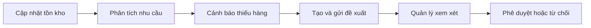
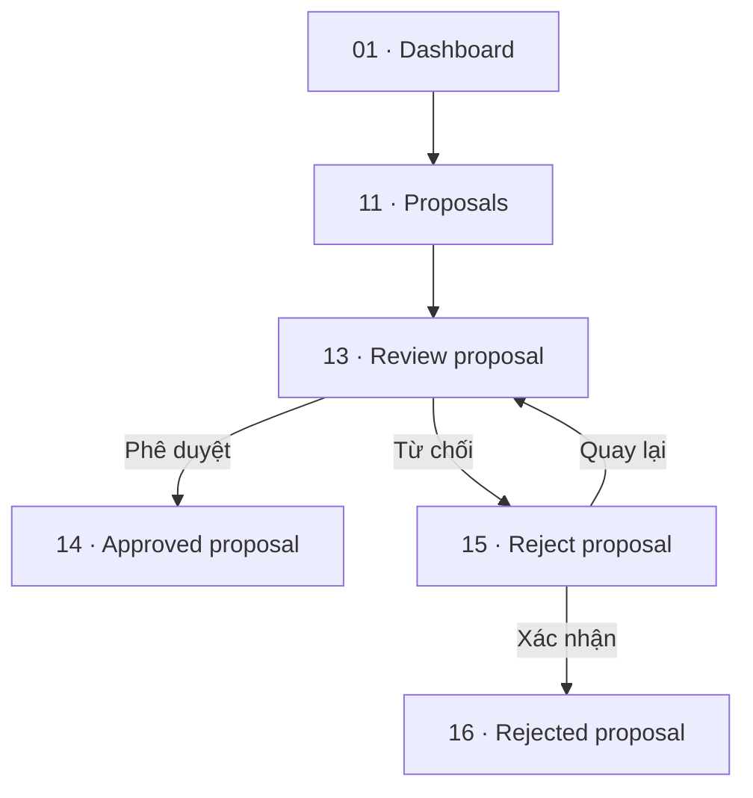

# Stockwise — UI/UX Walkthrough

Stockwise giúp theo dõi tồn kho, đề xuất nhập thêm hàng và phê duyệt đề xuất. Tài liệu này giải thích các màn hình 00–20 theo từng vai trò. Nhấn vào tên màn hình trong bảng để xem ảnh.

## 1. Tổng quan

| Vai trò | Công việc chính |
|---|---|
| Nhân viên kho (Staff) | Tra cứu và cập nhật số lượng tồn thực tế |
| Người lập kế hoạch (Planner) | Phân tích nhu cầu, phát hiện thiếu hàng, tạo và theo dõi đề xuất |
| Quản lý (Manager) | Xem tổng quan, phê duyệt hoặc từ chối đề xuất |



[00 · UX handoff](<./00 · Getting started/UX handoff.png>) là trang hướng dẫn prototype. Các ảnh dùng dữ liệu minh họa.

## 2. Nhân viên kho: cập nhật tồn

**Luồng:** Tồn kho → Chi tiết sản phẩm → Nhập số lượng mới → Lưu → Thành công.

| Màn hình | Người dùng làm gì? | Kết quả |
|---|---|---|
| [02 · Inventory · Staff](<./02 · Inventory · Staff.png>) | Tìm theo SKU hoặc tên, chọn **Xem chi tiết** | Mở đúng sản phẩm cần kiểm tra |
| [03 · Product detail · Staff](<./03 · Product detail · Staff.png>) | Xem tồn và đơn vị, chọn **Cập nhật số lượng** | Mở biểu mẫu cập nhật |
| [04 · Update stock · Staff](<./04 · Update stock · Staff.png>) | Nhập tổng tồn mới, chọn **Lưu thay đổi**; hoặc **Hủy** | Lưu số mới hoặc rời biểu mẫu |
| [05 · Update success · Staff](<./05 · Update success · Staff.png>) | Kiểm tra thông báo, chọn **Về danh sách tồn kho** | Biết số lượng đã đổi từ 60 thành 75 ram |

**Lưu ý:** nhập tổng tồn sau kiểm đếm. Nếu thực tế có 75 ram thì nhập `75`, không nhập phần chênh lệch `15`.


### Khi gặp vấn đề

| Màn hình | Tình huống | Cách tiếp tục |
|---|---|---|
| [19 · Validation states · Staff](<./19 · Validation states · Staff.png>) | Nhập `-5`; hệ thống báo chưa thể lưu | Chọn **Quay lại cập nhật**, nhập số nguyên ≥ 0 |
| [20 · Empty search · Staff](<./20 · Empty search · Staff.png>) | Không có sản phẩm khớp từ khóa | Sửa từ khóa hoặc chọn **Xóa tìm kiếm** |

## 3. Planner: tạo và theo dõi đề xuất

**Luồng:** Tồn kho → Phân tích nhu cầu → Cảnh báo → Chi tiết cảnh báo → Tạo đề xuất → Gửi duyệt → Theo dõi.

| Màn hình | Người dùng làm gì? | Kết quả |
|---|---|---|
| [06 · Inventory · Planner](<./06 · Inventory · Planner.png>) | So sánh tồn, nhu cầu/ngày và ROP; chọn **Phân tích SKU-001** | Nhận biết SKU cần kiểm tra |
| [07 · Demand analysis · Planner](<./07 · Demand analysis · Planner.png>) | Chọn SKU, khoảng ngày, **Áp dụng**; xem lịch sử và biểu đồ | Hiểu mức tiêu thụ, rồi chọn **Xem cảnh báo SKU này** |
| [08 · Low stock alerts · Planner](<./08 · Low stock alerts · Planner.png>) | Xem tồn, ROP và số ngày đủ dùng; mở chi tiết | Chọn sản phẩm cần bổ sung |
| [09 · Low stock detail · Planner](<./09 · Low stock detail · Planner.png>) | Kiểm tra cơ sở tính, chọn **Tạo đề xuất nhập hàng** | Hiểu vì sao sản phẩm cần nhập thêm |
| [10 · Proposal draft · Planner](<./10 · Proposal draft · Planner.png>) | Kiểm tra mức tồn mục tiêu và lượng nhập, chọn **Gửi phê duyệt** | Gửi đề xuất cho quản lý |
| [12 · Proposal submitted · Planner](<./12 · Proposal submitted · Planner.png>) | Xem xác nhận gửi và tiến trình | Đề xuất có trạng thái **Chờ duyệt** |
| [17 · Proposals · Planner](<./17 · Proposals · Planner.png>) | Lọc **Tất cả / Bản nháp / Chờ duyệt / Đã duyệt / Từ chối**, mở đề xuất | Theo dõi trạng thái các đề xuất |

### Ví dụ tính lượng nhập

Với SKU-001 trong ảnh:

```text
Nhu cầu/ngày = 600 ram ÷ 30 ngày = 20 ram/ngày
ROP = Nhu cầu/ngày × Lead time + Safety stock
    = 20 × 7 + 40 = 180 ram

Tồn hiện tại 60 < ROP 180 → Cần bổ sung

Lượng nhập = max(0, Mức tồn mục tiêu − Tồn hiện tại − Hàng đang đặt)
          = max(0, 500 − 60 − 100) = 340 ram
```

Mức tồn mục tiêu 500 ram là giả định trong thiết kế, cần thống nhất theo chính sách doanh nghiệp.


### Khi thiếu dữ liệu bán hàng

Ở [18 · Missing data · Planner](<./18 · Missing data · Planner.png>), hệ thống thông báo chưa đủ dữ liệu để tính nhu cầu và ROP, hiển thị dấu `—`. Người dùng chọn lại khoảng ngày hoặc sản phẩm có dữ liệu. **Không coi thiếu dữ liệu là nhu cầu bằng 0.**

## 4. Manager: phê duyệt hoặc từ chối



| Màn hình | Người dùng làm gì? | Kết quả |
|---|---|---|
| [01 · Dashboard · Manager](<./01 · Dashboard · Manager.png>) | Xem tổng SKU, SKU tồn thấp và đề xuất chờ duyệt; chọn **Xem đề xuất chờ duyệt** | Biết công việc cần xử lý |
| [11 · Proposals · Manager](<./11 · Proposals · Manager.png>) | Lọc **Chờ duyệt / Đã duyệt / Từ chối**, chọn đề xuất | Mở đề xuất cần xem xét |
| [13 · Review proposal · Manager](<./13 · Review proposal · Manager.png>) | Kiểm tra tồn, hàng đang đặt, mức mục tiêu, lượng đề xuất và người gửi | Chọn **Phê duyệt đề xuất** hoặc **Từ chối đề xuất** |
| [14 · Approved proposal · Manager](<./14 · Approved proposal · Manager.png>) | Xem xác nhận, người duyệt và thời điểm | Trạng thái **Đã duyệt**; không còn thao tác duyệt/từ chối |
| [15 · Reject proposal · Manager](<./15 · Reject proposal · Manager.png>) | Nhập lý do bắt buộc, chọn **Xác nhận từ chối**; hoặc **Quay lại** | Ghi nhận quyết định hoặc trở lại màn xem xét |
| [16 · Rejected proposal · Manager](<./16 · Rejected proposal · Manager.png>) | Xem lý do, người xử lý và thời điểm | Trạng thái **Từ chối**; có nút về danh sách |


**Phê duyệt chỉ ghi nhận đề xuất đã duyệt.** Tạo đơn mua hàng và tích hợp nhà cung cấp nằm ngoài MVP.

## 5. Trạng thái và quy tắc cần nhớ

| Trạng thái | Ý nghĩa |
|---|---|
| Bản nháp | Đề xuất đang được chuẩn bị, chưa gửi duyệt |
| Chờ duyệt | Đã gửi, đang chờ quản lý quyết định |
| Đã duyệt | Quản lý đã chấp thuận |
| Từ chối | Quản lý không chấp thuận và đã ghi lý do |

- Chỉ nhân viên kho cập nhật tồn; Planner lập đề xuất; Manager duyệt hoặc từ chối.
- Số lượng tồn phải là số nguyên ≥ 0; lượng nhập khuyến nghị không âm.
- Đề xuất đã xử lý không được duyệt hoặc từ chối lại.
- Sidebar cho biết khu vực hiện tại; nút xanh là hành động chính. Thông báo dùng cả chữ và màu để giải thích kết quả.

## 6. Lưu ý về dữ liệu mẫu

- Luồng Staff cập nhật tồn từ 60 lên 75 ram; luồng Planner minh họa với tồn 60 ram. Trong hệ thống thật, các vai trò phải dùng dữ liệu đã cập nhật.
- Ảnh 14 và 16 minh họa hai kết quả thay thế nhau của cùng đề xuất, không phải hai bước liên tiếp.
- Ảnh 07 ghi đơn vị biểu đồ là “cái”, trong khi SKU-001 dùng “ram”; cần thống nhất khi triển khai.

Tham khảo thêm: [Yêu cầu dự án](../../README.md) · [Information Architecture](../../INFORMATION_ARCHITECTURE.md).
